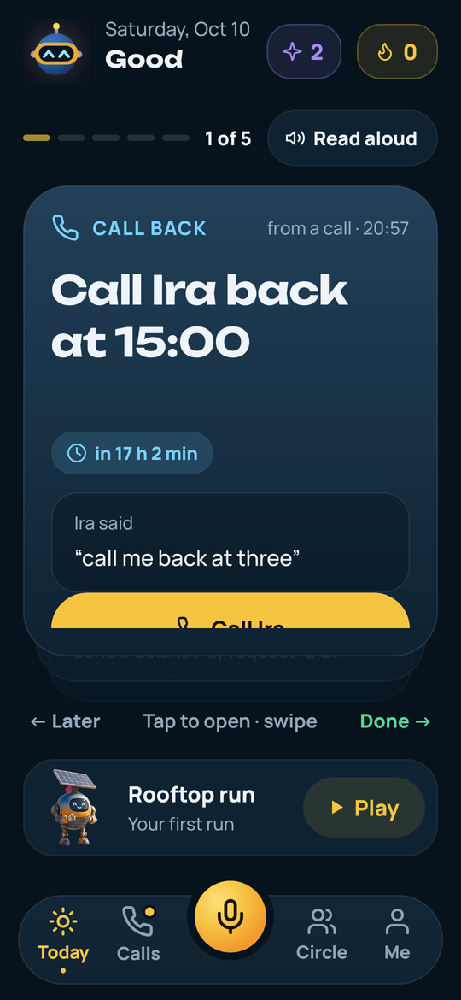
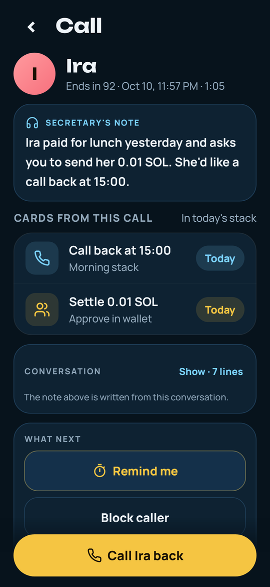
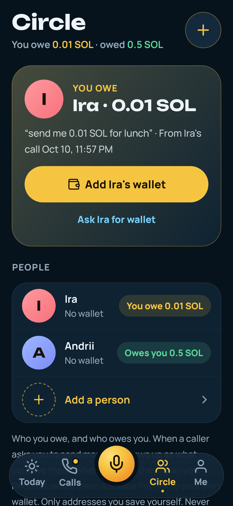
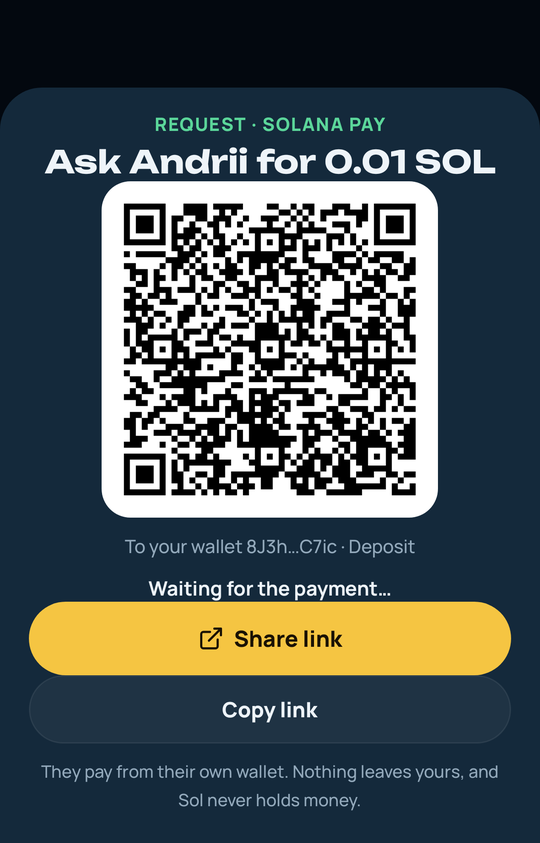
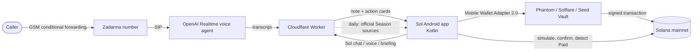

# Sol: AI secretary for Seeker

**Sol answers the calls you miss, and every morning one swipe clears what came out of them: call back, remind, or pay on Solana.**

I'm Vadym Bilobrovets, a solo founder from Ukraine. I miss calls in meetings, and some of those calls are people asking to be paid back. So I built Sol: an Android app with an AI secretary that picks up on a real phone line, writes me a short note, and turns the call into cards I clear in the morning. When a card is a payment, it's one tap and one approval in my own wallet, on Solana mainnet.

Built for the [Colosseum](https://www.colosseum.org/) hackathon (and the Solana Mobile CLOCK IN daily-habit track).

| Morning stack | Note from a call | Circle | Request by QR / SMS |
| --- | --- | --- | --- |
|  |  |  |  |

Videos: [tech demo](TECH_VIDEO_URL) · [pitch](PITCH_VIDEO_URL)

## Try it

1. On an Android phone (8.0 or newer), download `solarchik-assistant.apk` from the [latest release](https://github.com/Solar-DePIN-Hub/solarchik-assistant/releases/latest) ([direct link](https://github.com/Solar-DePIN-Hub/solarchik-assistant/releases/latest/download/solarchik-assistant.apk)) and allow the install when Android asks.
2. Open it. A short first-run guide explains the four parts below.
3. Call the shared demo secretary line, **+380 91 481 0885**, say who you are and what you want, and hang up. A note and cards show up in the app.
4. To pay or request money, connect Phantom or Solflare (Seed Vault on a Seeker). This is mainnet, so use tiny amounts.

The APK is signed with my own release key, not a store key. Package: `net.solardepin.solarchik.assistant`.

## What it does

- **Calls.** When I can't pick up, my carrier forwards the call (standard GSM conditional forwarding) to a Zadarma number. The call goes over SIP to an OpenAI Realtime voice agent that talks to the caller like a receptionist. My Cloudflare Worker saves the transcript, writes a short note (who, why, how urgent) and pulls out action cards: call back, reminder, or payment. The Calls tab keeps the history.
- **Today: the morning stack.** All of the day's cards in one stack: from calls, today's Seeker Season tasks, Circle debts and my habits. Each card says what it is and where it came from ("Call Ira back at 15:00, asked at 13:32"). Swipe right when it's done. Swipe left for Later (back to the end of today's stack), Tomorrow or Dismiss. Tapping a card does the action: opens the dialer, the payment, or the Season post. When every card is handled, I clock in and the streak grows. Signing a CLOCK IN memo on mainnet is optional.
- **Circle.** People I save myself, with their wallet address. Every person has **Send** and **Request**. Request makes a Solana Pay link and QR and opens an SMS ("Hi Ira, here's my payment link for 0.01 SOL"). Each link carries a one-off Solana Pay reference key, so when the money lands the app finds that transaction on chain (read-only) and shows **Paid ✓**. If a caller says "send me 0.01 SOL for lunch", the call adds that debt to Circle, linked to the call.
- **Me.** Wallet with SOL / USDC / SKR balances, **Send** and **Receive** (QR with my address, or request an exact amount). Daily habits I pick myself, including an optional "Save 1 USDC". Settings and wallet diagnostics.
- **Sol.** The mic button in the middle. Hold it and ask "who do I owe?" or "send Ira what I owe". Sol answers from my own data and opens the right card. He never sends anything by himself.
- **Season agent.** Every day the worker reads Solana Mobile's official sources (blog and docs) plus a dated, hand-checked list of partner drops announced on X, and puts today's Seeker Season tasks into the stack. Each task opens the original announcement. It doesn't claim, farm or sign anything.
- **Verified Seeker.** Sign In With Solana plus a Seeker Genesis Token check (Token-2022) on the server. It gives a badge and 10 extra secretary minutes a day. Everything else works without a Seeker.
- A small rooftop runner tile, left over from my first CLOCK IN build. It's a break, not the product.

## How it works



- The Android app is native Kotlin, no WebView. It holds no API keys; every model call goes through the worker.
- Worker source: [worker/solarchik-screen.js](worker/solarchik-screen.js) (calls, SIP, notes, Sol), [worker/assistant-extras.js](worker/assistant-extras.js) (call actions, briefing), [worker/season-drops.js](worker/season-drops.js) and [worker/season-rules.js](worker/season-rules.js) (Season), [worker/seeker-verify.js](worker/seeker-verify.js) (Genesis Token).
- AI phone minutes are capped per call (3 min), per account and per day, so a stuck call can't run up a bill.

## On-chain proof

Two real payments made from the app on my tablet on 10 Oct 2026, 0.01 SOL each from my wallet to Ira's, through Circle → Send → Phantom. Each one settled in about 3–4 seconds, with a fee of 0.00008 SOL.

| What | From → To | Amount | Slot | Transaction |
| --- | --- | --- | --- | --- |
| Circle payment #1 | `8J3h…C67ic` → `5sH2…7peL` | 0.01 SOL | 455365483 | [4z8PUAVD…ByLUnW6z](https://solscan.io/tx/4z8PUAVD99bFWRM2KHpAGFqarESNDxQBsKNVzsh3e2MCT65N79tgSKayRvfRSVZg8AMhJVnkA7ftUd22ByLUnW6z) |
| Circle payment #2 | `8J3h…C67ic` → `5sH2…7peL` | 0.01 SOL | 455400077 | [3BtXnkEf…F8bvdFFQbVTr](https://solscan.io/tx/3BtXnkEfWTbZbGSzEKFJVsrMTRYqBvGY39xMSd1gzdAEvWCBwFBLE13cYmqRug5xzgeA8Fv2XsDyF8bvdFFQbVTr) |

Wallets: [sender](https://solscan.io/account/8J3hxf1XSYV1HKVUJtwtQtVwSvSeaAyW5RmL8EqC67ic), [recipient](https://solscan.io/account/5sH2TB1x5gjYz9ReBfx9DjTjVX1kieYY41zCKjU47peL).

## Security

- **Nothing moves without my approval.** Every transaction is signed in the wallet app over Mobile Wallet Adapter. The app never sees a private key, and the server never holds one.
- **Simulated first.** Before the wallet opens, the app simulates the transaction on mainnet. If Solana would refuse it (not enough SOL, a new recipient below the rent minimum, no USDC), I get a plain reason instead of a failed signature.
- **No addresses from calls.** A payment only goes to an address I saved myself in Circle. If a caller dictates an address, the app shows a scam warning and ignores it.
- **App identity.** The wallet sees the app as `app.solardepin.net`, which serves a Digital Asset Links file for this package and signing certificate.
- **No secrets in the repo.** The keystore and its passwords live outside git (`keystore.properties` / environment variables). Worker keys are Cloudflare secrets.
- This is a hackathon build by one person, and it hasn't been audited. Start with tiny amounts.

## Business

- **Free:** Sol, the wallet, Circle, habits, and secretary minutes on the shared demo line.
- **Pro, $7.99 a month (proposed):** my own secretary number, more minutes, cards from every call.
- **Business (planned):** for small service businesses that miss calls while they work (barbers, repair shops, freelancers): own number, booking from the call, deposit requests.
- **A small fee on Circle payments** (planned, not in the app yet).

Go-to-market: Seeker owners first, because they already have a wallet on the phone; then small businesses.

Traction, honestly: it's live on mainnet and tested by 4 people, my family and friends. Nothing is billed yet.

## Roadmap

- Personal secretary numbers and Pro billing (USDC / SKR).
- Publish to the Solana dApp Store with a store key.
- Business plan pilot: booking and deposits from the call card.
- Test Seed Vault and the Genesis Token check on a real Seeker (I don't own one yet; I test on an Android tablet with Phantom).
- An external security review.

## Build from source

You need JDK 17 and the Android SDK (API 35). The Gradle wrapper (8.9) is in the repo.

```bash
cd artifacts/solarchik-handoff/android
echo "sdk.dir=$ANDROID_HOME" > local.properties   # if it isn't set already
./gradlew :app:testDebugUnitTest                   # unit + Robolectric tests
./gradlew :app:assembleDebug
```

Build output goes to `/tmp/solarchik-apk-build` by default (pass `-PbuildRoot=<dir>` to change it), so the APK is at `/tmp/solarchik-apk-build/outputs/apk/debug/app-debug.apk`. `assembleRelease` builds an unsigned APK unless `app/solarchik-release.jks` and its passwords (`keystore.properties` or `SOLARCHIK_STORE_PASSWORD` / `SOLARCHIK_KEY_PASSWORD`) are present.

The worker deploys with Wrangler; see [worker/DEPLOY.md](worker/DEPLOY.md).

## Links

- Pitch: [PITCH.md](PITCH.md) · Privacy: [PRIVACY.md](PRIVACY.md)
- Releases: https://github.com/Solar-DePIN-Hub/solarchik-assistant/releases
- My first CLOCK IN build (the game version, unchanged): https://github.com/Solar-DePIN-Hub/Solarchik
- X: [@SolarDePin](https://x.com/SolarDePin) · team.solardepinhub@gmail.com

## License

MIT, see [LICENSE](LICENSE).

## NVIDIA Nemotron on Nebius Token Factory (Nebius × NVIDIA Global AI Hackathon)

Sol's "brain" for turning phone calls into action cards now runs on **NVIDIA Nemotron** through **Nebius Token Factory** (OpenAI-compatible API, `https://api.tokenfactory.nebius.com/v1`).

| Step | Route | Model | Why |
| --- | --- | --- | --- |
| Call → action cards (payment, owed, callback, reminder) | `POST /call/actions` | `nvidia/nemotron-3-super-120b-a12b`, reasoning on | Reads the secretary's notes and the call transcript, then returns strict JSON (json_schema) with amounts, currency, day and time |
| Spoken morning briefing | `POST /sol/briefing` | `nvidia/NVIDIA-Nemotron-3-Nano-30B-A3B`, reasoning off | Fast and cheap (~1 s), plain speech for TTS |

Code: `worker/llm-provider.js` (provider chain, Nemotron settings, `<think>`/fence cleanup) and `worker/assistant-extras.js` (`chat()`). If Token Factory fails, OpenAI is the fallback.

Nemotron 3 counts its reasoning tokens against `max_tokens`, and the answer came back empty at our old limit of 900. So the action step raises the budget to 4000, and the briefing sends `chat_template_kwargs: {enable_thinking: false}`.

**Run it:**
```bash
cd worker
npx wrangler secret put NEBIUS_API_KEY -c wrangler.screen.toml   # key from tokenfactory.nebius.com
printf nebius | npx wrangler secret put LLM_PROVIDER -c wrangler.screen.toml
npx wrangler deploy -c wrangler.screen.toml
curl -X POST https://<worker>/call/actions -H 'content-type: application/json' \
  -d '{"language":"en","calls":[{"id":"me|c1","name":"Olena","note":"Olena asks you to send her 10 USDC and call her back at 3 pm.","date":"2026-10-22"}]}'
```
Optional env: `NEBIUS_MODEL`, `NEBIUS_FAST_MODEL`, `NEBIUS_BASE_URL`, `NEBIUS_THINKING=0`. Tests: `node --test worker/nebius-paypal.test.mjs` (network mocked).

### What changed since Aug 26, 2026 (start of the submission period)
- The call → action cards step and the daily briefing moved from a closed model to NVIDIA Nemotron (Super for reasoning, Nano for speech) on Nebius Token Factory, with a provider chain and fallback.
- Nemotron output handling: reasoning-token budget, thinking toggle per task, cleanup of `<think>` blocks and code fences, strict JSON schema output.
- Other work in the submission period, per this repo's git history (repo started Sep 19, 2026): the call → action cards and the spoken morning briefing (1.1.0, Oct 9), reminders with resolved dates and up to 3 actions per call (1.1.3, Oct 9), and the "owed" card type plus call transcripts in call detail (1.2.7, Oct 10).

## PayPal: "owes you" call → PayPal invoice (PayPal AI Hackathon)

**Try it without a phone:** https://solarchik-screen.davidbell1603.workers.dev/demo. Paste what a caller said, or tap an example. NVIDIA Nemotron turns it into action cards. On an "owes you" card, you confirm the amount, tap **Request via PayPal**, and get a sandbox invoice and pay link. The card switches to **✓ paid** once it's paid. Sandbox only, so no real money moves.

Flow:
1. `POST /call/actions` with `fiat:true` → an `owed` card with `amount`, `token` (USD/EUR/UAH or SOL/USDC/SKR) and `usdSuggested` (only for USD/USDC; SOL, SKR and UAH are never converted silently).
2. The user confirms or types the amount. Then `POST /paypal/invoice {confirmed:true, amount, currency:"USD"|"EUR", text, payerName?, payerEmail?}`. The route refuses to run without `confirmed:true`. It calls PayPal Invoicing v2 to create and send the invoice and returns `{id, payLink}`.
3. Paid status comes from `GET /paypal/invoice/status?id=INV2-…` (polls PayPal) and `POST /paypal/webhook` (`INVOICING.INVOICE.PAID/CANCELLED/REFUNDED`, verified with PayPal's verify-webhook-signature, stored in KV).

Code: `worker/paypal-invoice.js`, `worker/paypal-demo.js`, and the fiat owed cards in `worker/assistant-extras.js`. Tests: `node --test worker/nebius-paypal.test.mjs`, with the network mocked.

### Optional: Tavily web check on payment cards
When the worker has `TAVILY_API_KEY` set (`npx wrangler secret put TAVILY_API_KEY -c wrangler.screen.toml`), each **payment** card (someone asks you to pay) gets a web check. Tavily searches the *request pattern*, for example `Is this a scam: "Pay 2 SOL to unlock your delivery parcel"`, never the caller's number or name. The card shows Tavily's short answer and up to 3 source links. It runs at most twice per request with a 6 s timeout, and it never blocks the cards. Code: `worker/tavily-lookup.js`. Tests: `node --test worker/tavily-lookup.test.mjs` (network mocked). Without the key it does nothing.

### Run it with your own PayPal sandbox
1. Sign in at https://developer.paypal.com → Apps & Credentials → **Sandbox** → Create App. Copy the Client ID and Secret.
2. Set the worker secrets:
   ```bash
   cd worker
   npx wrangler secret put PAYPAL_CLIENT_ID -c wrangler.screen.toml
   npx wrangler secret put PAYPAL_CLIENT_SECRET -c wrangler.screen.toml
   printf 1 | npx wrangler secret put PAYPAL_ENABLED -c wrangler.screen.toml
   npx wrangler deploy -c wrangler.screen.toml
   ```
3. Optional webhook: create one in the app's Webhooks section pointing at `https://<worker>/paypal/webhook` with the `INVOICING.INVOICE.PAID` event. Then save its ID with `npx wrangler secret put PAYPAL_WEBHOOK_ID`. Polling works without it.
4. Open `https://<worker>/demo`. To pay an invoice, open the pay link and log in with a **sandbox Personal account** (Developer Dashboard → Testing Tools → Sandbox Accounts). Secrets never go in this repo.
